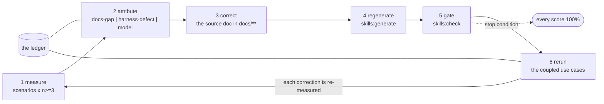

---
parts:
  - Node Tools
title: recursive-skill-improvement
eleventyNavigation:
  key: Node Tools >> recursive-skill-improvement
  title: recursive-skill-improvement
  order: 16
---

# recursive-skill-improvement

**Microbenchmarking your skills: 100% measured, 0% drift.**

## The flow




Six stations, one ring. The loop closes only when **every** score is 100% — on **both** axes, at n≥3,
on the live revision.

## The ledger

The ledger is not a report; it is the machine's memory, and everything else is derived from it.

**A row is one measurement.** Its key is `(skill revision, model, scenario, provider)` — and each part
of that key is load-bearing:

| Key part | Why it is in the key |
| --- | --- |
| **skill revision** | the **git tree hash of the skill directory**, not a commit sha — so an unrelated commit elsewhere in the repo cannot invalidate stored results, while a real change to the skill always does |
| **model** | a score belongs to a model; the same skill measures differently on different ones |
| **scenario** | one cell is one scenario x model; nothing is aggregated across scenarios |
| **provider** | plus the derived **subject** (`model` or `agent`), so an **agent** measurement and a **model** measurement never collide — and are never averaged |

**What a row stores.** The score (mean/min/max/stdDev) and the sample count; the **behaviour** result
(`passed/total`) separately from the convention score; the attempts; **dependency files read** and their
bytes — a non-zero value is a *failure signal*, because the answer should come from the skill, not from
reading the library source; the tokens (prompt/completion) and the **cost**, priced from a rate table
with sources; and `ranAt`.

**The honesty rules, enforced by the ledger.**

- **`n=0` means not attempted, never 0%.** A run that never touched the deliverable, or that died on a
  dead endpoint, is recorded as `n/a` and excluded from every average. Only **n≥3** is ever quoted.
- **Averages cover comparable runs only.** Non-attempted runs are kept out of the per-scenario and
  per-model aggregate too, so a dead endpoint can never drag a score down.
- **Retired models are marked, not deleted.** A withdrawn model id stamps its rows with `†`; the history
  stays readable and is excluded from the headline, so a retired model is never counted beside a live one.
- **A revision tilt makes every older cell stale — and says so.** When the skill changes, its rows are
  history by definition; the page shows fresh `n=0` markers instead of yesterday's numbers.
- **A correction owes a re-run.** Regenerate, gate, then re-measure the coupled use cases at n≥3. An edit
  without a re-run is a proposal, not a fix.

That is why the ledger is the backbone of the ring above: the loop reads its own memory to decide what to
fix, and the stop condition is a statement about the ledger, not about a feeling.

## The concepts

| | Concept | In one line |
| --- | --- | --- |
| 1 | **Test cases from the docs** | a scenario is a realistic user request; the checks encode what the source docs state, never what the prompt says |
| 2 | **Two axes** | *convention*: parses, imports only documented entrypoints, exports the demanded class. *behaviour*: works in a real browser |
| 3 | **The ledger** | every measurement keyed by revision, model, scenario, provider |
| 4 | **The loop** | measure → attribute → correct → regenerate → gate → rerun |
| 5 | **The exit** | 100% on both axes, at n≥3, on the live revision |

Everything is **generic**: the subject is *any* skill generated from source documentation. Port it to
another docs tree and only the **data** changes — the scenarios, the entrypoint policy, the coupling —
never the machinery.

## A concrete test case

**The scenario** — the prompt a user would actually write:

> *"Build a from-scratch form: a native `<form>` element, one field wired into it, and the client-side
> validation the library documents actually working."*

Only **neutral boilerplate** is fixed (the file is `src/my-elem.js`, the class `MyElem`, one
deliverable); every fact about *how* the library works stays in the docs, because that is what is
measured.

**The checks** — what the docs assert, none of it in the prompt: `importsResolve` (a relative import the
run never wrote), `namedExportsExist` (a binding the entrypoint does not export), a
**placeholder-specifier** check (an import from `<something>`), the **import-policy gate** (documented
entrypoints only), and the **behaviour tier** (mounted in a real browser and asserted).

## How a score moved: 0% → 100%

A component scenario failed **every** run at **0%**: the file parsed, imported only documented
entrypoints and exported the right class — and still did nothing, because it imported a **name that
entrypoint does not export**. That is a **docs gap**, so the fix went there: the docs now name **the
module that owns each element**. Regenerate, gate, re-run at n≥3: **0% → 100%, behaviour 3/3**.

A sharper one: the docs themselves taught a bug — a literal **placeholder specifier** in the skill's own
example, which models copied verbatim and **no check could see**. It is a check now.

## The docs work that took it to 100%

Every correction landed in the **source doc**, never in the generated skill:

| Docs work | Why |
| --- | --- |
| **Ownership** — which module ships which element | models guessed entrypoints that do not exist |
| **A generated entrypoint list** (the skill index) | a name that does not ship can never be recommended |
| **Synonyms in the index** | a user's vocabulary routes to the right component, without leaking into the prompt |
| **The real validator module** | the placeholder specifier above |
| **Compose vs extend**, per component | the consumer path is the documented path |
| **The two-role shadow-DOM rule** | a form control's substructure has its own rule; every control points at it |
| **Subclasser companions split out** | the extension surface became explicit instead of ambient |
| **Never a global define entrypoint** | models reach for it; the docs forbid it and a check enforces it |
| **Regenerate + gate on every change** | an edit without a re-run is a proposal, not a fix |

## Running it

```bash
npx recursive-skill-improvement sweep --models <model> --samples 3 --behaviour
npx recursive-skill-improvement improve --models <model> --samples 3
```

Installed globally (`npm i -g recursive-skill-improvement`) the same tasks answer to `rsi`. Results per
scenario and model: [quality](/fundamentals/node-tools/recursive-skill-improvement/quality/) ·
[index](/fundamentals/node-tools/recursive-skill-improvement/skill-index/).
