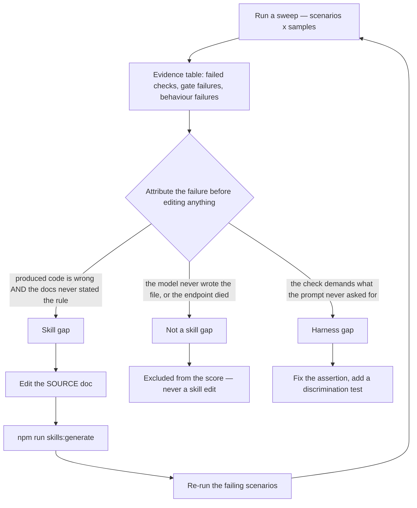

# The self-improvement loop, worked through

This is the harness's own process, written up from a real campaign: how a failing check becomes a
documentation change rather than a guess, and — more importantly — how to tell the difference between
a skill gap and something that only looks like one. The companion workflow lives in
`packages/ui/skills/recursive-skill-improver`; this page is the worked example.

## The loop



The middle decision is the whole process. A failing check is only evidence about the _skill_ if the
produced code is wrong **and** the documentation never stated the rule it violated. If the model never
wrote anything, or the endpoint died, the run says nothing about the skill; if the check demanded
something the prompt never asked for, the fault is in the harness and the fix belongs there. Getting
this wrong produces confident, well-written improvements to a skill that was never at fault.

## Worked example: the entrypoint that did not exist

A full sweep — 42 scenarios x 3 samples, one model, behaviour enabled — scored a 92.8% mean. The
evidence table then showed that most of the failure was **one mistake, repeated**: the model guessed an
`@lion/ui` entrypoint from an element or a concept name.

| Guessed specifier      | Status  | Where the API actually lives                              |
| ---------------------- | ------- | --------------------------------------------------------- |
| `@lion/ui/checkbox.js` | missing | `LionCheckbox` is in the `checkbox-group` component       |
| `@lion/ui/option.js`   | missing | `LionOption` is in the listbox component                  |
| `@lion/ui/validate.js` | missing | the validators are in the form module that documents them |

Attribution was not a judgement call — every guessed specifier is absent from `packages/ui/exports/`,
and the failures appear in the sweep's evidence table:

- **7 runs zeroed** by the import gate (checkbox x3, validate x3, option x1);
- **5 of the 6 browser failures** were the same mistake reaching the browser, because a module that
  cannot resolve cannot load. The sixth was a run that never wrote its file at all — classified
  _not attempted_, not a skill gap;
- no check of the _shape_ of the code could have caught it. The import looked documented; only
  resolving it showed otherwise.

That is a skill gap: the documentation said "import through the documented entrypoints" and never said
that the entrypoint is the **module an API is documented under**, which is not a name you can derive
from the element. So the rule went into the source docs:

- `docs/fundamentals/systems/core/ScopedElementsMixin.md` — the rule, the three measured traps, and the
  heuristic that an element usually shares a module with its siblings (`lion-checkbox` and
  `lion-checkbox-group` are one component);
- `SKILL.md`'s Rules section — the same rule where a model reads first, pointing at the reference.

Then `npm run skills:generate` rebuilt the skill from those sources, and the run was verified: the rule
is present in the generated reference, the hand-written Rules bullet survives regeneration, and
`npm test` stays at 88/88.

The follow-up that would retire the class of failure rather than discourage it: generate the list of
real entrypoints into the skill. Sixty-seven specifiers exist under `packages/ui/exports/`, the
generator already reads that directory, and a model given the list cannot guess.

## Counter-example: a failure that was _not_ attributed

Two scenarios failed and got no documentation edit at all:

- `integration/native-form-to-lion-form` — `imports LionForm from '@lion/ui/form.js'` and
  `no longer renders a native <form>` failed on all three samples;
- `repair/iban-field` — the golden similarity was 28% on all three samples.

Both look like documentation gaps. Neither was verified as one. The model not performing a migration
might mean the docs never showed the before/after — or it might mean the task was simply not attempted
well, and editing docs to accommodate that would teach the skill to explain rather than to be correct.
The artifacts have to be read before either scenario earns a doc edit.

## Counter-example: when the harness was at fault

Early in the same campaign, four correct answers across three models were failed because a check
demanded a component shape its prompt never mentioned. The fix belonged in the **assertion**, not the
documentation — and the documentation was deliberately _not_ narrowed to suit the check. The rule
that came out of it is mechanical, and now runs before a model does:

- the scenario linter gained the reverse direction: a check may not demand an element the prompt never
  names, unless the check itself accepts an alternative shape;
- the assertion was widened to the outcome the prompt demands, and a **discrimination test** was added
  so the check is proven to distinguish a right answer from a wrong one — including a control that
  fails for the right reason, because an assertion that has never been seen to fail is not yet a check.

Two other harness bugs in the same campaign are the reason the first decision in the diagram exists:

- **a no-op scored 42.9%.** An untouched file satisfied "the file exists" and "contains no native
  input", so doing nothing collected partial credit. A no-op is now _not attempted_, excluded from the
  score and reported as an attempt rate — and must never become a skill edit;
- **one endpoint failure killed a whole measurement run.** A transient 429/5xx is now recorded as
  _to redo_, excluded from the score, and the sweep survives it. With no comparable runs there is no
  score at all: the page prints `n/a`, never `0%`.

## Running it

```bash
# one scenario, one model, with behaviour
npm run eval -w packages-node/skill-tester -- \
  --models <model> --scenario component/accordion --samples 3 --behaviour

# a full sweep, publishing the ledger and the results page
npm run eval -w packages-node/skill-tester -- \
  --models <model> --samples 3 --behaviour --docs
```

Measured cost of a full sweep: 42 scenarios x 3 samples is 126 runs in about 42 minutes, roughly $1 on
a cheap model. The wall-clock matters more than the money, which is why the sample count is the knob
worth turning: below three samples a cell is indicative only, and a single sample is never quoted.

Read the run record's evidence table first, attribute each failure with the diagram above, and only
then edit the documentation — at the source, so the skill is regenerated from it rather than patched.
